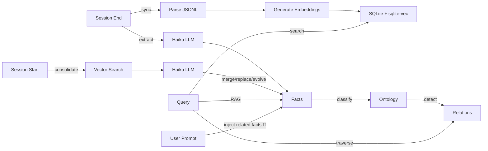
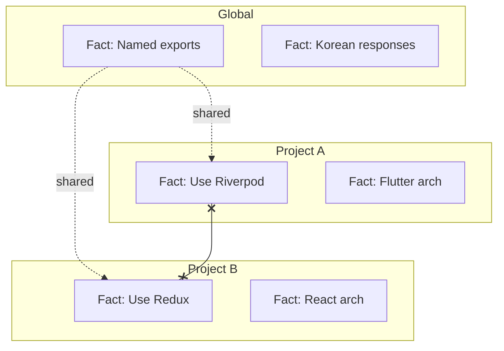

# Memory Bank

> Conversations → Knowledge Graph. Claude Code conversations become searchable, structured knowledge.


## What's New in v1.4.x

- 🧾 **Injection pipeline v2 — session dedup ledger (v1.4.0)** — a fact is now injected at most **once per session**. Before: 74% inject rate × 5.5–8 facts × ~140 chars ≈ **~470 tokens per prompt**, with the *same* facts re-injected across a session (~10k tokens per 30-prompt session). A bounded per-session ledger (400 ids, 7-day TTL, atomic writes, fail-open) filters already-injected facts; a repeated topic's 2nd occurrence injects **0 bytes** (`status:"deduped"`)
- ✂️ **Token budget** — per-fact 160-char truncation + 1,000-char block budget (lowest-relevance facts dropped first), plus an elapsed-budget gate on repeated-prompt detection: its 313k-exchange vector search (p95 498ms) is synchronous and cannot be preempted mid-flight, so it is skipped entirely when injection has already spent >700ms
- 📈 **Savings are measured, not assumed** — the inject log gains `chars` (block size) and `deduped` (facts saved) fields, so real-world token savings accumulate in observable JSONL
- 🌌 **Knowledge Galaxy (`ui/relations/`)** — Three.js 3D visualization of the ontology: 32 domains / 4.2k categories / 24.7k facts / 27.8k typed relations as a navigable galaxy — fact search, per-type edge toggles (SUPPORTS/INFLUENCES/SUPERSEDES/CONTRADICTS), relation-navigating detail panel, adaptive performance (compositor-only labels, point-size cap, eco-mode DPR). `node ui/relations/generate-data.mjs` then serve statically — the data file stays local (personal facts, gitignored)
- 🩹 **Dependency self-heal (v1.4.2)** — `claude plugin update` non-deterministically skips `npm install` for the new cache dir, and cc-sync ships plugin caches to other machines without `node_modules`. The dep-free injection thin client now detects `ERR_MODULE_NOT_FOUND` and spawns a one-shot detached `npm install` (atomic marker prevents loops), so a broken install heals itself on the first prompt
- 📦 **Packaging fix (v1.4.1)** — v1.4.0 shipped a stale committed `dist/`; the release checklist now hard-checks `git status dist/` is clean before tagging
- Earlier releases: see [CHANGELOG](CHANGELOG.md) — v1.3.x added ontology backfill batching (~25×), headless LLM spawn isolation, the classification attempt ledger, vec-index self-heal, worker flood caps, and the warm inject daemon (~2.3s → ~0.07s per prompt)

## Features

- **Knowledge Graph** -- Ontology classification (Domain → Category) + typed relations (INFLUENCES, SUPPORTS, SUPERSEDES, CONTRADICTS)
- **RAG Search** -- Search results auto-enriched with related facts and ontology context
- **Conversation Search** -- Semantic vector search + FTS5 (BM25) full-text search across all past conversations
- **Full-History Analysis** -- `memory-bank analyze` + `analyzing-all-conversations` skill: coverage-checked report over the entire conversation *index* (projects, facts, domains, timeline, backfill gaps) — run `memory-bank sync` first so new conversations are indexed
- **Context Injection** -- Related past decisions are automatically prepended to every prompt (UserPromptSubmit hook): baseline-margin relevance gate + 1-hop ontology expansion + per-session dedup ledger and token budget (v1.4.0), with fail-loud JSONL observability logs
- **Fact Extraction** -- Automatic extraction of decisions, preferences, patterns from conversations (trivial-exchange filtering, in-session dedup, confidence gating, LLM call budgeting)
- **Fact Consolidation** -- Duplicate detection, contradiction handling, evolution tracking
- **Graph Traversal** -- Multi-hop exploration (up to 3 hops) to trace decision chains
- **Cross-Project Insights** -- Find similar decisions from other projects
- **Fact Provenance** -- Trace any fact back to its source conversation
- **Scope Isolation** -- Project facts stay in their project, global facts are shared
- **User Tags** -- The one labelling axis you control: free-form tags that the automatic pipeline never overwrites. Use them for review layers (`verified`), grouping that crosses project scope (`billing`), or case collection (`bug-report`). See the [tagging guide](docs/tagging-guide.md)
- **Compressed Archive Support** -- Transparent `.jsonl.zst` reads across every path (parser, `read` tool, search, sync, stats, verify) using Node's built-in zstd (Node >= 22.15) — archives compressed out-of-band keep working
- **MCP Integration** -- 11 tools: `search`, `read`, `search_facts`, `search_ontology`, `ask_avatar`, `trace_fact`, `explore_graph`, `cross_project_insights`, `graph_stats`, `tag_fact`, `list_tags`
- **3D Visualization** -- Interactive neon-style knowledge graph with data flow animation
- **Web UI** -- Dark-theme web interface for browsing and searching conversations

## How It Works

### Data Pipeline

```
▲ Prompt Input       User messages, tool calls, assistant responses
│                    → JSONL archiving → embedding (384-dim)
│
◎ User Scope         LLM extracts facts (decisions, preferences, patterns)
│                    → global facts shared across all projects
│
● Project Scope      Facts scoped per project, clustered by domain
│                    → cross-project insights available
│
◇ Ontology           Auto-classified into domains & categories
                     → typed relations: INFLUENCES / SUPPORTS / SUPERSEDES / CONTRADICTS
                     → multi-hop graph traversal (up to 3 hops)
```




## Install

In Claude Code:
```
/plugin marketplace add https://github.com/jung-wan-kim/memory-bank
/plugin install memory-bank
```

## Update

```
/plugin update memory-bank
```

## Quick Start

```bash
memory-bank sync      # Sync & index conversations
memory-bank search "React auth"  # Semantic search
memory-bank stats     # Index statistics
memory-bank analyze   # Full-history analysis report (coverage, projects, facts)
```

## Context Injection

Every user prompt (≥20 chars) triggers the `UserPromptSubmit` hook, which vector-searches your facts and prepends relevant past decisions to the prompt:

```
📌 관련 과거 결정:
- [decision] Use keyset pagination for PostgREST list reads (2026-06-23)
- [SUPPORTS] [constraint] All tables require RLS policies, no exceptions (2026-05-18)
```

- **Relevance gate** — a fact is injected only when its similarity to the query exceeds the query's own background baseline by a margin (absolute thresholds cannot separate relevant from irrelevant on compressed e5 scores)
- **1-hop expansion** — top matches pull in related facts via typed ontology relations (max 8 facts total)
- **Repository family scope (v1.7.8)** — a prompt in a worktree (`<repo>/.auto-issue-worktrees/…`) or a sub-folder (`<repo>/docs`) also sees the project facts of the same repository, and the repository sees what was learned in worktrees placed inside its folder (a worktree placed outside it sees the repository, not the other way round). A path that no longer exists (a cwd or a fact's path) has no family — which repository a deleted path belonged to cannot be told from the disk — so facts learned in a worktree that has since been deleted no longer reach the family (a loss taken for isolation: none of the 83 lines the family added in the replay sample came from a deleted path). Inside a worktree container (`<repo>/.claude/worktrees/`, `<repo>/.auto-issue-worktrees/`) only the root's own linked worktrees count — a container can hold other repositories' worktrees. A cwd that is a symbolic link or a file, or that reaches its repository through a symbolic link (a link to the root itself included), has no family, and a fact path through a symbolic link under a root is left out (facts are left out, never pulled in); a linked worktree whose main repository is named through a symbolic link joins nothing but itself. A slug-form project resolves to a path through the conversation index (the matching cwd, else the most used one) on both the vector search and the relation path, and gets that path's family; an unresolved slug has none. Worktrees of a bare repository (`.bare/worktrees/…`) are not grouped — each is its own family. Roots come from `.git` on disk and must be a real repository (a `.git` folder holding HEAD, or a `.git` file naming an existing git dir; a linked worktree joins its main repository only when its `gitdir` back-reference matches); a home directory (`$HOME` or the account's own) and its ancestors never become a root; matching is on a `/` boundary, so `<repo>` never sees `<repo>-extra`, and never reaches into another repository nested under a root (a separate clone or a submodule). Chosen by the replay bench below; the SessionStart key-facts block is unchanged
- **Session dedup ledger (v1.4.0)** — a fact already injected in this session is never re-injected (it is already in the conversation context); repeated topics cost 0 extra tokens. Ledger is per-session, bounded (400 ids), TTL-pruned (7 days), and fail-open
- **Token budget (v1.4.0)** — each fact is truncated to 160 chars and the whole block capped at 1,000 chars (lowest-relevance dropped first); repeated-prompt detection is skipped when injection has already spent >700ms (the sync sqlite search cannot be preempted once started)
- **Observability (v1.2.1, extended v1.4.0)** — every run appends one JSONL line to `~/.config/superpowers/conversation-index/logs/inject-context.jsonl`:

  ```json
  {"ts":"2026-07-12T07:36:35Z","status":"injected","prompt_len":67,"candidates":5,"injected":8,"deduped":0,"chars":969,"duration_ms":528,"via":"fallback"}
  {"ts":"2026-07-12T07:36:41Z","status":"deduped","prompt_len":67,"candidates":5,"injected":0,"deduped":8,"duration_ms":476,"via":"fallback"}
  ```

  Since v1.7.8 a line also carries `top_margins` (each candidate's similarity minus the baseline), `gated_ids` (ids that cleared the gate before the session ledger), `injected_ids`, `session_key` (sha256 prefix of the session id) and `plugin_version`, and the SessionStart key-facts block writes its own `"via":"session-start"` line (count, chars, ids, `source`).

  Node-level crashes (missing `node_modules`, import failures) land in `logs/inject-context.err.log` instead of being discarded.

**Injection replay bench (v1.7.8)** — replays prompts the hook really saw (inject log ∩ indexed conversation, as of each prompt's moment) through selection variants and has an isolated LLM judge score each injected line 0/1/2 against random-fact controls:

```bash
npm run build
node bench/inject-replay.mjs --build && node bench/inject-replay.mjs --replay && node bench/inject-replay.mjs --check-determinism
node bench/inject-judge.mjs --smoke && node bench/inject-judge.mjs --judge   # rows written before bindings: --bind-legacy
node bench/inject-judge.mjs --report --doc docs/bench/<date>-inject-replay.md && node bench/inject-judge.mjs --leak-check docs/bench/<date>-inject-replay.md
```

Prompt and fact text stay in `.bench-out/`; the report holds aggregates only. 2026-10-19 result (`docs/bench/2026-10-19-inject-replay.md`, 303 prompts): 55.4% of injected lines judged at least related, 20.5% directly useful; repository family scope kept (+0.126 directly useful lines per affected prompt, 95% CI 0.047–0.228), a query gate on relation neighbours rejected. The family gain came entirely from one repository (its main folder and linked worktrees) — by where the prompt's cwd was (not where the useful facts came from): prompts in worktrees placed inside the repository folder gained +12 directly useful lines, prompts in linked worktrees placed outside it +4, prompts in the repository folder itself 0; the other repositories' 22 affected prompts gained nothing and are too few to judge on their own.

**Troubleshooting**: if injection never fires, check those two files — an empty/absent JSONL log means the hook isn't running at all (stale plugin install, restart pending), while `"status":"error"` entries or err.log content pinpoint the failure.

## Full-History Analysis

`memory-bank analyze` aggregates the entire conversation **index** into one report — deterministic, read-only, no LLM calls. It reports on what has been indexed into SQLite: archive files that were never synced are not visible to it. The SessionStart hook syncs in the background, but that runs asynchronously — when freshness matters, run `memory-bank sync` (foreground) and let it finish before analyzing.

```bash
memory-bank analyze                    # Markdown report to stdout
memory-bank analyze --json             # Raw JSON for scripting
memory-bank analyze --top 30 --out ~/report.md   # Top 30 projects, saved to file
```

The report covers:

| Section | Contents |
|---------|----------|
| Coverage | Conversations (main sessions vs agent transcripts), sessions, exchanges, date range |
| Pipeline coverage | Fact extraction done/pending %, summary done/missing % |
| Facts | Active/inactive counts, by category, by scope |
| Knowledge domains | Top ontology domains by fact count |
| Projects | Per-project rollups: conversations, sessions, exchanges, facts, activity range |
| Timeline | Monthly session/exchange activity |
| Recommendations | Which backfills to run to close analysis gaps |

The **`analyzing-all-conversations` skill** builds on this: it runs the analysis, kicks off
backfill for unanalyzed sessions (`scripts/backfill-extract-worker.js` — lock-protected and
resumable), then enriches the numbers with fact/ontology search into an organized report.
Trigger it with requests like *"모든 대화 분석"*, *"analyze all my conversations"*.

## Fact System

Facts are automatically extracted at session end and consolidated at session start.

Extraction quality/cost controls (v1.2.0):
- Trivial exchanges (bare slash commands, harness artifacts, short acknowledgements) are filtered before any LLM call
- Duplicate facts within a session are dropped across batches (normalized comparison)
- Facts without a valid numeric confidence ≥ 0.7 are rejected
- Long sessions cap LLM calls with evenly-spread batch sampling (`MEMORY_BANK_MAX_EXTRACT_CALLS`, default 12)

| Category | Example |
|----------|---------|
| `decision` | "Using Riverpod for state management" |
| `preference` | "Named exports only" |
| `pattern` | "Bug-fixer retries 3 times on error" |
| `knowledge` | "API endpoints at /api/v2/" |
| `constraint` | "No localStorage usage" |

### Consolidation Rules


| Relation | Action |
|----------|--------|
| DUPLICATE | Merge (count++) |
| CONTRADICTION | Replace old + revision history |
| EVOLUTION | Update + revision history |
| INDEPENDENT | Keep both |

### Scope Isolation



Project A sees: Project A facts + Global facts (never Project B). Since v1.7.8 the per-prompt injection widens to Project A's repository family (see Context Injection): a worktree or sub-folder sees the repository's facts, and the repository sees what was learned in worktrees placed inside its folder — not those placed outside it (one-way); a different repository stays out.

## MCP Tools

| Tool | Description |
|------|-------------|
| `search` | Semantic/text search + RAG context (related facts auto-attached) |
| `read` | Display full conversation from JSONL |
| `search_facts` | Query facts with ontology context + graph relations |
| `search_ontology` | Browse ontology hierarchy (Domain → Category → Facts) |
| `ask_avatar` | Ask your technical alter ego — answers grounded in past decisions |
| `trace_fact` | Trace a fact back to its source conversations |
| `explore_graph` | Multi-hop graph traversal (1-3 hops) from any fact |
| `cross_project_insights` | Find similar decisions from other projects |
| `graph_stats` | Knowledge graph statistics and health |

### Knowledge Graph Tools

```bash
# Trace why a decision was made
trace_fact --query "state management" --limit 3

# Find how other projects solved auth
cross_project_insights --query "authentication" --current_project ./my-app

# Explore decision chains
explore_graph --query "database choice" --hops 3
```

## Skills

Installed automatically with the plugin:

| Skill | When it triggers | What it does |
|-------|------------------|--------------|
| `remembering-conversations` | "how should I...", "last time we...", stuck on a problem | Dispatches the search agent over past conversations and returns synthesized findings |
| `analyzing-all-conversations` **(new in v1.2.0)** | "모든 대화 분석", "대화내역 정리", "analyze all conversations" | Runs `memory-bank analyze`, starts backfill for unanalyzed sessions, and produces an organized full-history report |

## Web UI

A cinematic dark-theme web interface for browsing and searching your conversation history.


### Features

- **Projects View** -- Browse all projects grouped by category, sorted by latest/most/A-Z
- **Search** -- Full-text search across all conversations
- **User Prompts** -- Browse and search only user messages
- **Exchange Detail** -- View full user/assistant messages with tool call history
- **Hue OS Publication** -- Q&A-only personal mirror chat backed by the personal mirror artifacts in `~/.codex/personal-mirror`

### Run

```bash
node ui/server.cjs
# Memory Bank UI: http://localhost:3847
# Hue OS: http://localhost:3847/hue-os
```

Custom port:
```bash
PORT=8080 node ui/server.cjs
```

> **Note:** Requires `memory-bank sync` to have been run at least once to populate the database.
> The Hue OS publication route (`/hue-os`, with `/replacement-os` kept as a compatibility alias) can still load from local Personal Mirror artifacts when the conversation database is unavailable.
> Chat defaults to local terminal CLIs instead of API keys: Claude via `claude --print --model sonnet`, GPT via `codex exec --model gpt-5.5`.
> Override with `REPLACEMENT_OS_CLAUDE_COMMAND`, `REPLACEMENT_OS_CLAUDE_ARGS_JSON`, `REPLACEMENT_OS_GPT_COMMAND`, or `REPLACEMENT_OS_GPT_ARGS_JSON`.
> If local terminal providers are unavailable, the route falls back to a deterministic safety-preserving response mode.
> Public sharing guardrails: `/hue-os` requires password login (`REPLACEMENT_OS_ACCESS_PASSWORD`, default `0525`; 4 digits auto-submit in the login UI) and limits each client IP to 200 chat requests per local day (`REPLACEMENT_OS_DAILY_LIMIT`, reset at 00:00). The chat UI hides provider selection, disables Send during responses, shows an in-chat loading bar while Hue OS answers, and uses Esc to cancel an in-flight answer.
> Hue OS answer boundary: it refuses access/security-sensitive questions, including passwords, tokens, cookies, env values, server/tunnel URLs, auth bypasses, quota bypasses, and security-weakening instructions.
> Vercel sharing bridge: `vercel/hue-os/` is a standalone Vercel project that proxies `/api/hue-os/*` to a public HTTPS tunnel for this local server. Vercel cannot call your private `localhost` directly; keep this server running and set `HUE_OS_LOCAL_ORIGIN` to the tunnel/reverse-proxy origin so Claude/Codex subscription CLI auth stays local.

## Claude Desktop Integration

Share Claude Code's memory with Claude Desktop by adding the MCP server:

Edit `~/Library/Application Support/Claude/claude_desktop_config.json` (macOS):

```json
{
  "mcpServers": {
    "memory-bank": {
      "command": "node",
      "args": ["/path/to/memory-bank/cli/mcp-server-wrapper.js"]
    }
  }
}
```

Replace `/path/to/memory-bank` with the actual plugin path (check `~/.claude/plugins/`).

Claude Desktop will then have access to all your Claude Code conversations and extracted facts via the same `search`, `read`, and `search_facts` tools.

## Configuration

```bash
# Fact extraction model (default: claude-haiku-5-5)
export MEMORY_BANK_FACT_MODEL=claude-haiku-5-5
export ANTHROPIC_API_KEY=your-key

# Summarization model
export MEMORY_BANK_API_MODEL=opus

# Fact extraction LLM call budget per session (default: 12, evenly-spread batches)
export MEMORY_BANK_MAX_EXTRACT_CALLS=12

# Decompression cap for .zst archives (bytes; lowering only, default 256 MiB)
export MEMORY_BANK_MAX_DECOMPRESSED_BYTES=268435456

# Ontology backfill worker (per-run caps; absolute ceilings apply regardless)
export BACKFILL_ONTOLOGY_MAX=200      # facts per run (ceiling 1000; 0 disables)
export BACKFILL_EXTRACT_MAX=40        # sessions per run (ceiling 200; 0 disables)
export BACKFILL_BATCH_SIZE=20         # facts per LLM call (ceiling 50)
export BACKFILL_CONCURRENCY=4         # concurrent batch calls (clamped to [1, 8])
export BACKFILL_RELATIONS=0           # 1 = also detect relations during backfill

# Deterministic category-reuse gate (DISABLED by default — live measurement
# showed only 72% top-1 agreement at sim>=0.93; opt in after re-measuring
# with scripts/measure-det-gate.mjs)
# export MEMORY_BANK_ONTOLOGY_DET_GATE=0.94

# Session-start maintenance (pending-work probes + fact-vector compaction):
# at most once per this many minutes (default 360; 0 = every session start).
# A run where a step failed retries after 60 minutes instead.
# Each run is logged to ~/.config/superpowers/conversation-index/logs/maintenance.jsonl
export MEMORY_BANK_MAINTENANCE_INTERVAL_MIN=360

# Node binary for hooks when the default `node` was built for a different ABI
# than the installed better-sqlite3 (error: "NODE_MODULE_VERSION … requires …").
# Hooks find a matching node on PATH / Homebrew / nvm / volta / fnm / asdf on their own;
# set this only when none is found.
# export MEMORY_BANK_NODE=/opt/homebrew/opt/node@22/bin/node

# Time budget (ms) of the UserPromptSubmit injection hook, used to bound that
# re-run. Default 30000 = Claude Code's default for this hook; set it to match
# if you give the hook a different timeout.
# export MEMORY_BANK_INJECT_HOOK_BUDGET_MS=30000
```

Maintenance scripts (run by hand, never automatically):

```bash
node scripts/compact-vec-tables.mjs [--db PATH] [--min-ratio 0.8] [--dry-run]   # drop deleted slots from the fact vector tables
node scripts/migrate-vec-facts-int8.mjs --dry-run                              # fact vectors float32 → int8 (scale 600); see the script header
node scripts/migrate-vec-facts-int8.mjs --restore BACKUP.jsonl.gz              # back to float32 from its verified backup
```

## 3D Knowledge Graph

Interactive visualization of the full knowledge graph with neon-style nodes and data flow animation.


```bash
open docs/graph-3d.html   # Interactive 3D graph (local)
```

4 layers: **Prompt Input** → **User Scope** → **Project Scope** → **Ontology**, with animated particles showing data flow direction.

## Architecture

```
~/.config/superpowers/
├── conversation-archive/       # Archived JSONL files (plain or .jsonl.zst — read transparently)
└── conversation-index/
    └── db.sqlite               # SQLite + sqlite-vec
        ├── exchanges           # Conversation data + embeddings
        ├── tool_calls          # Tool usage records
        ├── facts               # Extracted facts + embeddings
        ├── fact_revisions      # Change history
        ├── ontology_domains    # Domain hierarchy
        ├── ontology_categories # Category classification
        ├── ontology_relations  # Typed fact relations
        ├── vec_exchanges       # Vector index (384-dim)
        └── vec_facts           # Vector index (384-dim)
```

## Development

```bash
npm install && npm test && npm run build
```

## License

MIT
